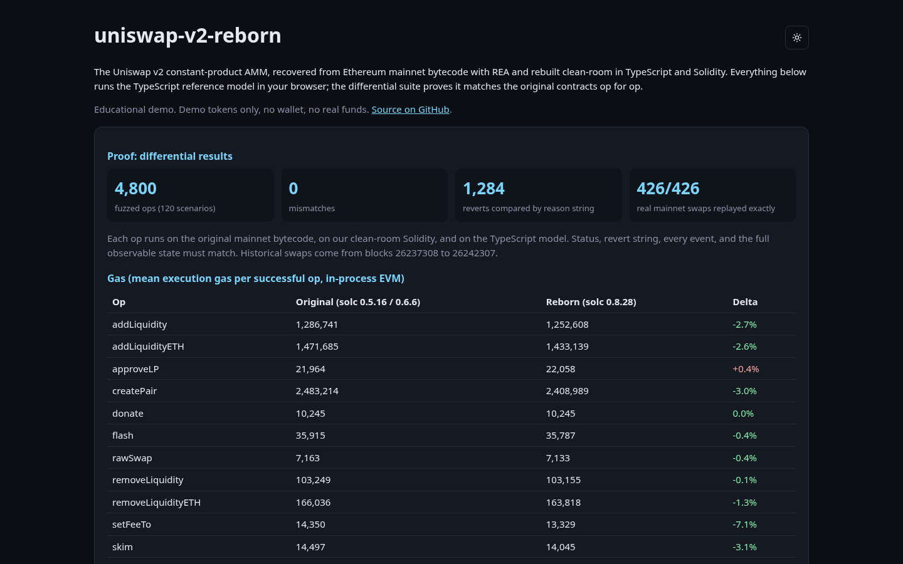
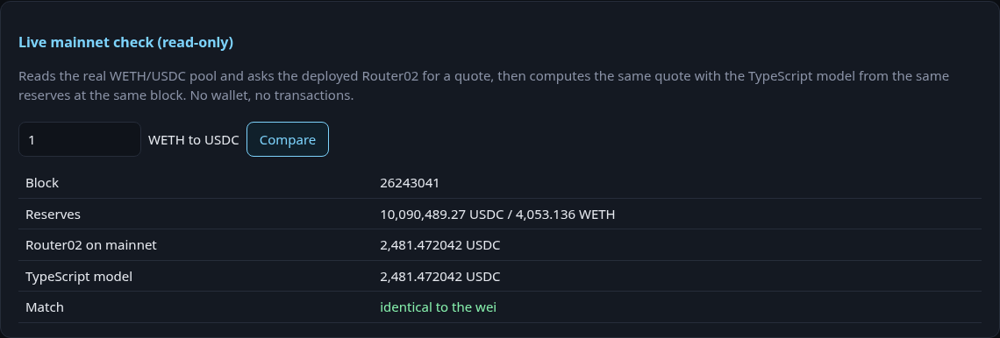
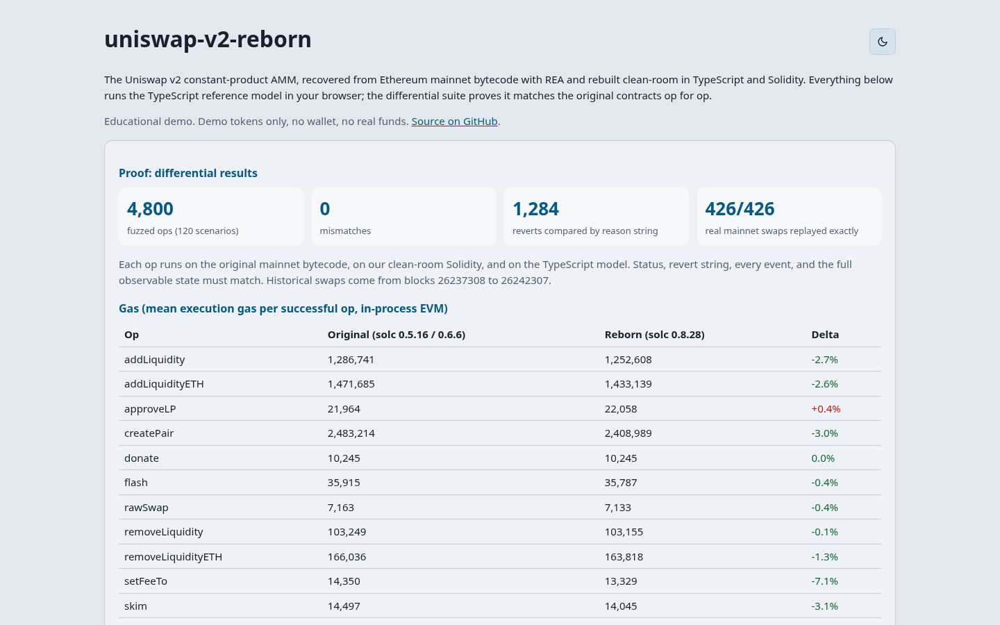
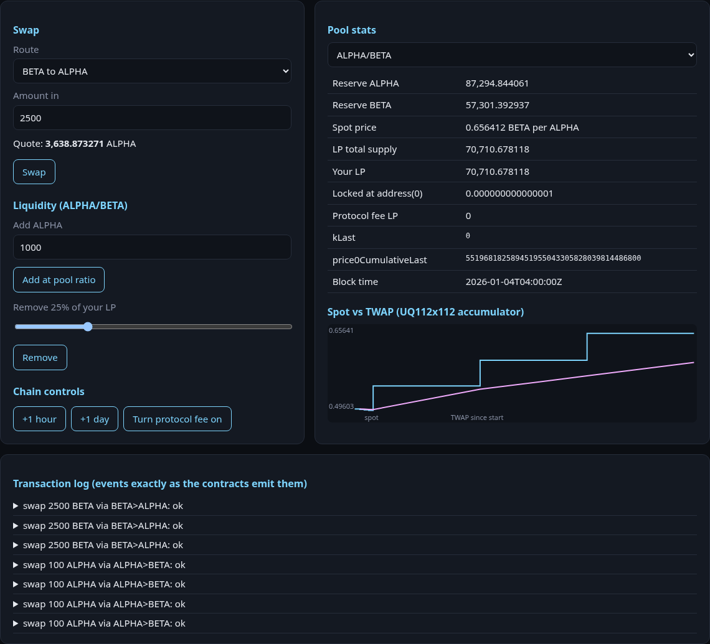

# uniswap-v2-reborn

The Uniswap v2 constant-product AMM (factory, pair, Router02) recovered from Ethereum mainnet **runtime bytecode** with [REA](https://github.com/morluto/rea), rebuilt clean-room as a TypeScript reference model and as Solidity 0.8 contracts, and proven equal to the original by differential testing.

[](https://uniswap-v2-reborn.vercel.app)
[](https://github.com/devtechedge/uniswap-v2-reborn/actions/workflows/ci.yml)


[](LICENSE)

## Live Demo

**https://uniswap-v2-reborn.vercel.app**

> Static site, fully client-side. The simulator runs the proven TypeScript model in your browser with demo tokens and resets on reload. The mainnet check makes read-only calls to a public Ethereum RPC. No wallet, no signatures, no real funds. The Solidity contracts are not deployed to any public network.

## Screenshots



| Live mainnet check | Light theme |
|---|---|
|  |  |



## Results

| | |
|---|---|
| Differential fuzz | **4,800 ops** over 120 seeded scenarios, original bytecode vs reborn Solidity vs TS model, **0 mismatches** |
| Historical replay | **426 / 426** real mainnet WETH/USDC swaps reproduced exactly on original, reborn and model |
| What is compared | success or revert, exact revert string, every event in order, full state after every op |
| Harness check | 7 / 7 planted bugs caught by the mutation check |
| Tests | 29 Vitest + 15 Forge (3 fuzz tests at 512 runs each) |
| Gas | reborn is within -7.1% to +2.4% of the original per op |

## Features

- Interface, events, revert strings and storage layout recovered from bytecode alone (59 selectors, 0 unknown)
- TypeScript reference model of the full system: mint, burn, swap, flash swaps, skim, sync, protocol fee, TWAP oracle, Router02 incl. multi-hop and ETH paths
- Clean-room Solidity 0.8.28 factory, pair, LP token with permit, and router, keeping every original revert string
- Differential harness running original mainnet bytecode in an in-process EVM, plus replay of real mainnet swaps
- Browser simulator with pool stats and a spot vs TWAP chart, and a live read-only quote check against mainnet Router02
- SHA-256 hashed evidence for every artifact

## Tech Stack

| Layer | Technology |
|-------|------------|
| Analysis | REA (rea-agents 6.7.0, evmole) |
| Model and harness | TypeScript, viem, @ethereumjs/evm, Vitest |
| Contracts | Solidity 0.8.28, Foundry (forge, anvil) |
| Web | Next.js 15 static export, React 19 |
| Tooling | pnpm, Turborepo, GitHub Actions, Vercel |

## How it was built

1. **Pin the bytecode.** `eth_getCode` for the factory, the WETH/USDC pair, Router02 and WETH9, hashed into [`evidence/`](evidence).
2. **Recover the interface with REA.** `rea inspect-evm-interface` found 8 factory, 27 pair and 24 router selectors with mutability and compiler metadata (solc 0.5.16). Names were resolved by hashing candidate signatures from the public docs: 0 unknown. Event topics and every revert string were scanned from the bytecode, and the storage layout was recovered by probing slots against getters.
3. **Write specs** ([pair](specs/PAIR.md), [factory](specs/FACTORY.md), [router](specs/ROUTER02.md)) including quirks: `Transfer(0, 0, 1000)` on first mint, fee-on mint formula, uint112 overflow guard, wrapping accumulators, INVALID on division by zero.
4. **Model** the whole system in TypeScript ([`packages/model`](packages/model)).
5. **Rebuild** in Solidity from the specs ([`contracts/src`](contracts/src)).
6. **Prove** with [`packages/differential`](packages/differential): the original bytecode runs in `@ethereumjs/evm` at its mainnet addresses with seeded storage, our contracts run on a second chain, and both are compared to the model op by op.

Details: [architecture](docs/ARCHITECTURE.md), [contract by contract](docs/CONTRACTS.md), [evidence format](docs/EVIDENCE.md), [compatibility matrix](docs/COMPATIBILITY.md), [results and gas](docs/RESULTS.md), [security notes](docs/SECURITY.md).

## Gas comparison

Mean execution gas per successful op from the full differential run (in-process EVM, excludes intrinsic gas).

| op | original | reborn | delta |
|---|---|---|---|
| addLiquidity | 1,286,741 | 1,252,608 | -2.7% |
| addLiquidityETH | 1,471,685 | 1,433,139 | -2.6% |
| createPair | 2,483,214 | 2,408,989 | -3.0% |
| swapExactIn (router) | 69,558 | 71,234 | +2.4% |
| swapExactOut (router) | 70,248 | 71,919 | +2.4% |
| swapExactETHIn | 74,634 | 76,146 | +2.0% |
| swapExactInForETH | 87,947 | 87,575 | -0.4% |
| flash swap | 35,915 | 35,787 | -0.4% |
| removeLiquidity | 103,249 | 103,155 | -0.1% |
| removeLiquidityETH | 166,036 | 163,818 | -1.3% |
| skim | 14,497 | 14,045 | -3.1% |
| sync | 14,911 | 14,829 | -0.5% |
| setFeeTo | 14,350 | 13,329 | -7.1% |

addLiquidity averages include the pair deployment when the pool did not exist yet.

## Quick Start

Requires Node >= 22.19, pnpm 9 and Foundry.

```bash
git clone --recursive https://github.com/devtechedge/uniswap-v2-reborn && cd uniswap-v2-reborn
pnpm install
pnpm build && pnpm test                      # model, differential (small), replay, web
cd contracts && forge test && cd ..          # Solidity unit and fuzz tests
pnpm --filter @v2r/differential diff 120 40  # full differential run -> reports/differential.json
npx tsx packages/differential/src/replay-cli.ts  # all 426 historical swaps -> reports/historical.json
./scripts/mutation-check.sh                  # plant bugs, expect the fuzzer to catch them
./scripts/deploy-local.sh                    # deploy reborn to a local anvil (unlocked account, no keys)
pnpm --filter @v2r/web dev                   # web app on localhost:3000
```

Re-capture evidence (optional): `node scripts/fetch-bytecode.mjs`, `rea inspect-evm-interface evidence/bytecode/<Name>.hex hex --format json --full-output`, `node scripts/summarize-evidence.mjs`, `node scripts/probe-storage.mjs`, `node scripts/fetch-historical-swaps.mjs`.

## License

Our code is MIT ([LICENSE](LICENSE)). Uniswap v2 core and periphery are GPL-3.0; **none of their Solidity source is included or was used**. The rebuild was derived from public mainnet bytecode (kept as test fixtures), REA analysis and public documentation. "Uniswap" is used only to identify the system being studied; this project is not affiliated with or endorsed by Uniswap Labs. See [THIRD_PARTY_NOTICES.md](THIRD_PARTY_NOTICES.md) and [DISCLAIMER.md](DISCLAIMER.md).

Educational and interoperability research only. Not audited. No mainnet deployment.
